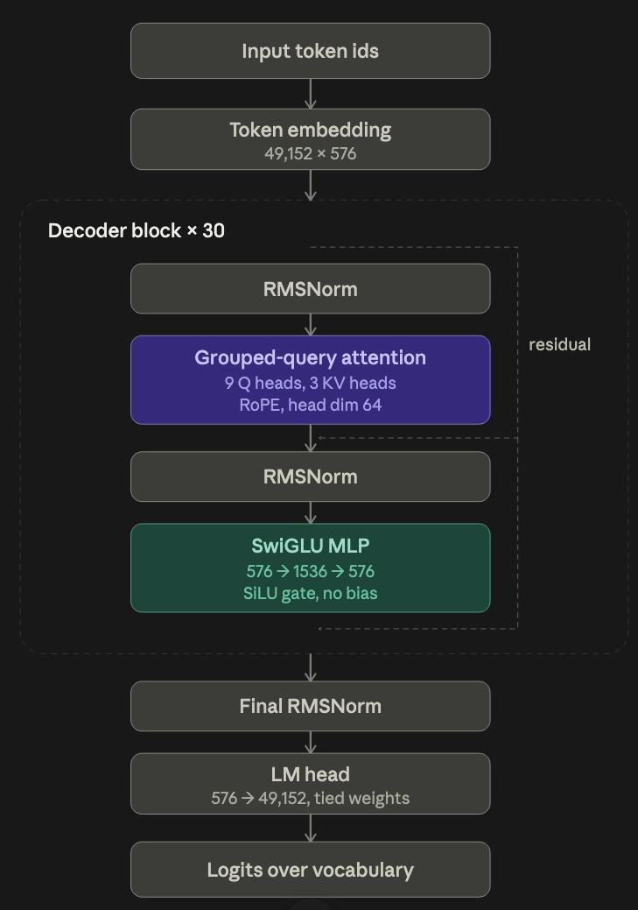

# AI-SmolLM2-135 Model

## Model Overview

SmolLM2 is a compact language model, available in 3 sizes, 135M, 360M and 1.7B parameters.
It generates content in English and is trained on 2 trillion tokens.
- Train set url: https://huggingface.co/datasets/HuggingFaceTB/smol-smoltalk
- Fine Tuning code: https://huggingface.co/datasets/HuggingFaceTB/smol-smoltalk


## Parameters
```
Architecture Type: Decoder only
Precision            : bfloat16
Layers               : 30
Vocalb Size          : 49,152
Hidden Size          : 576
Attention Heads      : 9 query, 3 key/value
MLP Intermediate Size: 1536
Position Encoding    : RoPE
Activation Function  : SiLU
Norm                 : RMSNorm
```

## Architecture Diagram (Decoder Only) 


## Architecture Description


 
