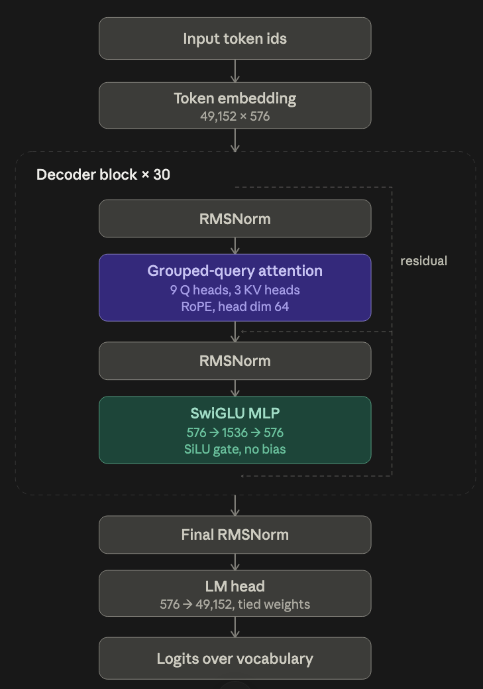

## Model Overview

SmolLM2 is a compact language model, available in 3 sizes, 135M, 360M and 1.7B parameters.
It generates content in English and is trained on 2 trillion tokens.
- Train set url: https://huggingface.co/datasets/HuggingFaceTB/smol-smoltalk
- Fine Tuning code: https://huggingface.co/datasets/HuggingFaceTB/smol-smoltalk


## Parameters
```
Architecture Type: Decoder only
Precision            : bfloat16
Layers               : 30
Vocalb Size          : 49,152
Hidden Size          : 576
Attention Heads      : 9 query, 3 key/value
MLP Intermediate Size: 1536
Position Encoding    : RoPE
Activation Function  : SiLU
Norm                 : RMSNorm
```

## Architecture Diagram (Decoder Only) 


## Architecture Description

SmolLM2 (specifically the 135M configuration shown) uses a decoder-only Transformer architecture with a hidden size (d_model) of 576, a vocabulary size of 49,152, and 30 stacked decoder blocks (x 30).


### 1. Input Layer (Token IDs)

- Role: A tokenizer splits raw text into subword tokens and maps each token to an integer ID in the range [0, 49,151] (0-indexed for a vocabulary of 49,152 tokens).

- Output: A 1D sequence of integer token IDs of length L (or shape (batch_size, L) when batched), with no learned parameters in this step.


### 2. Token Embeddings (49,152 x 576)

- Role: Acts as a learned lookup table containing 49,152 rows and 576 columns.

- How it works: Each integer token ID indexes into its corresponding row, replacing a single integer with a dense 576-dimensional floating-point vector ((L, 576)).

- Why it's needed: Raw token IDs are arbitrary labels with no inherent mathematical meaning or similarity structure. Training updates this embedding table so tokens with related meanings, roles, or contexts occupy useful regions in the 576-dimensional vector space.

  - Example: "cat" (or its token ID) maps to a learned 576-float vector rather than a single integer.


### 3. Decoder Block (x 30) & Residual Connections

The model repeats the same decoder block 30 times sequentially using a Pre-Norm layout (normalizing before each sub-layer) and residual (skip) connections (x + Sublayer(Norm(x))). Residual connections preserve information flow and provide clean gradient paths across all 30 blocks.


#### RMSNorm (Normalization Layers)

- Role: Root Mean Square Layer Normalization scales activations to keep values at a stable, predictable magnitude across 30 deep layers, preventing activations or gradients from growing too large or shrinking too small.

- How it differs from LayerNorm: Instead of subtracting the mean and dividing by standard deviation, RMSNorm scales by the root-mean-square energy of the vector (with a learned per-dimension scale weight, and no mean-centering), reducing computation while maintaining training stability.

- Placement: Each decoder block contains two RMSNorm layers—one before Grouped-Query Attention and one before the SwiGLU MLP—followed by a Final RMSNorm after all 30 blocks.


#### Grouped-Query Attention (GQA)

- Role: Enables tokens to attend to earlier tokens in the sequence (with causal masking so positions cannot attend to future tokens) and pull in relevant context.

- Query, Key, and Value (Q, K, V):

  - Query (Q): Represents what the current token is looking for to enrich its context.

  - Key (K): Acts like an index/label advertising what each token offers for matching.

  - Value (V): Holds the actual content/information passed along once a Query matches a Key.

- Heads & Dimensions (9 Q heads, 3 KV heads, head dim 64):

  - Each head operates in a 64-dimensional subspace (head_dim = 64).

  - There are 9 Query heads (9 x 64 = 576) and 3 Key/Value heads (3 x 64 = 192 per KV projection), meaning each KV head is shared across a group of 3 Query heads (9 / 3 = 3). Sharing KV heads reduces KV-cache memory during generation while retaining strong quality.

  - After attention, the 9 x 64 = 576 head outputs are concatenated and projected (576 -> 576) before adding to the residual stream.

- RoPE (Rotary Position Embedding): Applies position-dependent rotations to Q and K vectors in pairs of dimensions (32 pairs for a 64-dim head). Because rotating Q and K encodes token position directly into their inner product, attention scores naturally reflect relative distance between tokens rather than relying on added positional embeddings.


#### SwiGLU MLP (576 -> 1536 -> 576, SiLU gate, no bias)

- Role: A position-wise feed-forward network that transforms each token's representation after attention—combining features and acting as a non-linear feature processor/memory.

- Expansion & Gating: Expands the 576-dim vector to an intermediate width of 1,536 (roughly (8/3) * 576, a standard SwiGLU width) and projects back to 576, with no bias terms. It uses a SwiGLU gate (SiLU activation on the gate branch multiplied element-wise with the up-projected branch) to selectively pass or suppress features before projecting back to 576.


### 4. Final RMSNorm

- Applied once after the 30th decoder block to normalize the final 576-dimensional hidden states before the output projection.


### 5. LM Head (576 -> 49,152, tied weights)

- Role: Projects each token's final 576-dimensional vector into 49,152 raw scores (logits)—one score for every token ID in [0, 49,151] indicating how likely that token is next.

- Tied weights: Shares weights (transposed) with the 49,152 x 576 Token Embedding matrix rather than using a separate output matrix, saving parameters and coupling input/output token representations.


### 6. Softmax & Token Selection

- Softmax: Converts the 49,152 logits (optionally adjusted by temperature) into positive probabilities that sum to 1.0 (100%).

- Selection: Chooses the next token ID (0 to 49,151)—either deterministically via argmax (picking the highest-probability token) or via sampling (e.g., top-k / top-p sampling) to introduce variety. In autoregressive generation, this chosen token ID is appended to the input sequence for the next step.
